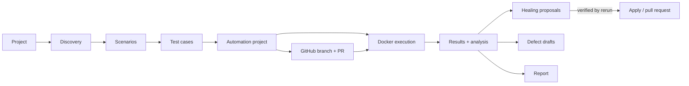

# AI Autonomous Testing Studio

A Streamlit application that takes a website URL and produces a reviewed, runnable, self-healing automated test suite:
website discovery, scenarios, test cases, automation code, GitHub commit/PR, containerised execution, failure analysis,
locator healing, defect drafts and reports. The language model is NVIDIA Nemotron
(`nvidia/nemotron-3.5-super-vl-120b-a12b`) through the OpenAI SDK.

The UI is Streamlit only. Nothing runs in the browser except Streamlit.

## Quick start

```powershell
py -m venv .venv ; .venv\Scripts\activate
pip install -r requirements.txt
python -m playwright install chromium
copy .env.example .env          # set NVIDIA_API_KEY (or MODEL_API_KEY)
streamlit run app.py
```

* Testing an app on `localhost` or an intranet host: set `ALLOW_PRIVATE_NETWORK=true`.
* No Docker on the machine: set `EXECUTION_MODE=local` (tests run as a separate OS process, without container isolation).
* Docker (recommended for execution): `docker compose up --build` (see "Docker").
* Keys can also live in `.streamlit/secrets.toml`; nothing is hard-coded.

## Accounts and sign-in

Everyone signs up (email and password, or Google / GitHub when configured) and gets a private workspace: projects, runs and
reports belong to the account and are never listed to anyone else. Sessions last 30 days ("Keep me signed in"); passwords are
bcrypt-hashed, accounts lock for 10 minutes after 5 wrong passwords, and "Forgot password?" emails a 6-digit code when `[smtp]`
is configured (without it, anyone who knows an email can reset that account, so set it before exposing the app).
Projects created in a browser before accounts existed move to the account the first time you sign in from that browser.

To run the studio on your own machine, run `streamlit run app.py` locally: your accounts (`users.db`) and projects stay in your
own data folder (`DATA_DIR`, default `data/`), nothing is sent anywhere. Optional sign-in providers are configured in
`.streamlit/secrets.toml`; copy the `[auth]`, `[auth.google]`, `[github]` and `[smtp]` examples from
`.streamlit/secrets.toml.example`.

## Workflow



Every AI output is a draft. Scenarios, test cases and the generated project each need a human approval, and AI changes
reset the approval of whatever they touch. Once every scenario is approved the studio moves on to the Test cases page.

### How discovery explores an application

Discovery behaves like a tester rather than a link crawler. When credentials are configured it signs in once and, inside
that live session, clicks through the navigation (sidebar items, menus, navigation radios, tabs, links and view-changing
buttons); then it explores the signed-out views (welcome, sign-in, sign-up, password reset) in a fresh session. Each
distinct view is recorded with the clicks that open it ("How to reach"), so single-page apps that keep one URL and hold the
sign-in in memory (Streamlit, React, ...) are mapped completely. Controls that change data, leave the application or end
the session (log out, delete, save, send, submit, upload, social sign-in, ...) are never clicked, and form submit buttons
are skipped. The project's page limit and link depth bound the exploration; `DISCOVERY_TIMEOUT_SECONDS` bounds its time.

## Architecture

| Layer | Package | Responsibility |
| --- | --- | --- |
| UI | `app.py`, `ats/ui/` | Pages (Projects, Discovery, Scenarios, Test cases, Automation, GitHub, Execute, Results, Reports, Status and audit), sidebar tracker, live run view |
| Workflow | `ats/workflow.py` | Computes stage state from stored data (nothing is kept only in the session) |
| Model layer | `ats/ai/` | OpenAI-SDK client for Nemotron (streaming `reasoning_content`/`content`, thinking mode, retries, JSON repair, schema validation, call log) and the agents |
| Discovery | `ats/discovery/` | Isolated Playwright worker: click-through exploration of signed-in and public views, DOM/accessibility extraction, screenshots, forms, auth |
| Locators | `ats/locators/` | Locator repository: ranked, deduplicated, uniqueness-checked selectors with alternatives |
| Generation | `ats/generation/` | Scenario and test-case services, framework adapters (Playwright Python/TypeScript/JavaScript, Selenium Python/Java), Excel exporters |
| Automation | `ats/automation/` | Script service, bundle store, validation against the locator repository, traceability |
| Execution | `ats/execution/` | Runner (Docker or local), JUnit and evidence parser, executor with cancel and live log |
| Analysis | `ats/analysis/` | Failure evidence, rule classifier, AI analysis, healing engine, defect builder |
| GitHub | `ats/github/` | REST client and service: branch, commit, pull request, import |
| Reporting | `ats/reporting/` | Report assembly and HTML / Excel / JSON / ZIP exporters |
| Storage | `ats/db.py`, `ats/repository.py` | SQLite behind a repository API (PostgreSQL-ready: all SQL lives in the repository) |
| Cross-cutting | `ats/config.py`, `ats/security.py`, `ats/logging_setup.py`, `ats/errors.py` | Settings, secret masking, URL safety, logging, user-facing errors |

## Agents

| Agent | Purpose |
| --- | --- |
| `WebDiscoveryAgent` | Understands the application from the crawled pages (purpose, user flows, risks) |
| `LocatorIntelligenceAgent` | Names elements by intent and ranks locator strategies |
| `ScenarioAgent` | Business scenarios by coverage level (BASIC to FULL, or custom categories) |
| `TestCaseAgent` | Detailed test cases with automation steps, one scenario at a time |
| `ScriptGenerationAgent` | Maps test-case steps to locator-repository elements (never invents selectors) |
| `FailureAnalysisAgent` | Classifies failures from error, DOM, screenshot and executed steps |
| `SelfHealingAgent` | Proposes replacement locators that must be present in the failing DOM |
| `ReportAgent` | Executive summary, risks and recommendations |
| `GitHubAgent` | Branch names, commit messages and PR text |

Agents never touch the filesystem, the database or the network directly; services do, and services validate every
agent output (schema, grounding in discovered elements, allowed actions).

## Nemotron layer

* Config: `MODEL_NAME`, `MODEL_BASE_URL`, `MODEL_API_KEY` / `NVIDIA_API_KEY`, `MODEL_TEMPERATURE`, `MODEL_TOP_P`,
  `MODEL_MAX_TOKENS`, `MODEL_SEED`, `MODEL_ENABLE_THINKING`.
* `enable_thinking` is sent as `extra_body={"chat_template_kwargs": {"enable_thinking": ...}}`.
* Streaming responses surface `reasoning_content` and `content` separately in the "AI model activity" panels.
* Replies are parsed as JSON, repaired when possible, validated with Pydantic, and re-requested with the validation
  error on failure. Only timings and token counts are logged (Status and audit page), never prompts or responses.
* Screenshots are sent to the vision-language model during discovery and failure analysis when `MODEL_USE_VISION=true`.

## Data model (SQLite)

`projects`, `discoveries`, `locators`, `scenarios`, `test_cases`, `bundles` (generated files live on disk), `github_links`,
`executions`, `results`, `healings`, `defects`, `jobs`, `audit_log`, `ai_calls`, `schema_version`. Rows are owner-scoped by the id of the
signed-in account, so one person never lists another person's projects (see "Accounts and sign-in"). Accounts are kept in a
separate SQLite file, `users.db` in the data folder (`USERS_DB` overrides the path).

## Execution

* Docker mode: Playwright projects run in the official Playwright images; Selenium projects in `ats-runner-selenium-python`
  / `ats-runner-selenium-java`, built on first use from `docker/runners/`. Resource limits come from `DOCKER_CPUS`,
  `DOCKER_MEMORY`, `DOCKER_SHM_SIZE`. Secrets are passed as environment variables inherited from the process, never on the
  command line.
* `localhost` base URLs are rewritten to `host.docker.internal` inside containers.
* Generated tests write evidence per test case (`steps.json`, `failure.json`, `dom.html`, `screenshot.png`) next to JUnit XML.
* Statuses: PASS, FAIL, HEALED (passed only after a verified fix by auto-fix), INCONCLUSIVE (flaky or unexplained), SKIPPED.

## Background jobs (nothing stops when you lock the laptop)

Discovery, scenario / test-case / automation generation, AI change requests and test runs are **jobs**. A job runs in a thread of the
server process and writes its progress (percentage, status line, log, model activity) to the `jobs` table, so it keeps going when the
browser tab is closed, the screen locks or the connection drops. Any page, in this or a new session, shows the live progress bar of the
running job (also as small bars in the sidebar); when you come back the result is simply there. If the server itself restarts, jobs that
were running are marked *Interrupted* and can be started again. Jobs started from the UI can be cancelled.

## How generated tests find and reach elements

* Discovery records, for every view, the clicks that open it (`config/views.json`) and verifies on the live page how many elements each
  candidate selector matches; unique selectors are ranked first, ambiguous ones last. Icon-font text (`add`, `keyboard_arrow_left`) is not
  part of an element's name, exactly like in Playwright's accessibility tree.
* The generated runtime (`utils/app.py`, `utils/nav.py`, shared with discovery) opens the application (waking a sleeping Streamlit Cloud app
  and stepping into its embedded frame), signs in with the credentials of the environment variables named in `config/auth.json`, replays the
  recorded clicks to reach the view a test starts on, waits for single-page apps to settle, and clicks like a person (forced / DOM click when a
  styled radio or checkbox hides the real input).
* Elements are resolved with the preferred selector first and the recorded alternatives next; a selector that only worked as a fallback is
  written to `reports/evidence/<id>/fallbacks.json` and promoted to the preferred selector by auto-fix.

## Execution results, auto-fix and failure reports

1. Execute shows the stage timeline (prepare, run, analyze, auto-fix, report), a per-test live table and the runner log.
2. Every failure is classified from its evidence (error, DOM at the failure, screenshot, executed steps).
3. With **Auto-fix** on (default) the studio repairs what is the automation's fault: fallback selectors are promoted, stale locators are healed
   against the failing DOM, and the Test Repair agent fixes scripts (wrong start view, missing click or wait, wrong sequence) with exact,
   validated text replacements. It never deletes or weakens an assertion and never hardcodes credentials. Repaired tests are re-run
   (up to `AUTOFIX_MAX_ROUNDS`, default 3); a pass is reported as **HEALED**, not PASS.
4. The fixed project is saved to the bundle and pushed to the project's GitHub branch (needs the project's token from the GitHub page).
5. What is left is either a proven application defect (the repair agent verified the automation is right) or something that could not be fixed
   automatically. Both become a **failure report** with steps to reproduce, expected vs actual result and evidence, ready to share with the customer.
6. With Auto-fix off, the previous policies apply: `manual` (a person approves each locator fix) or `auto_pr` (a pull request with verified fixes).

## GitHub

The token is held in memory per project (never stored). **Publish** creates a *clean* branch: a root commit that contains only the generated
test project, none of the files of `main` or any other branch. Publishing again (and auto-fix pushes) add commits to that same branch, and each
commit replaces the whole tree, so removed files disappear. The default branch is never touched. Because a clean branch shares no history with
`main`, no pull request can be opened from it; the advanced option "create the branch from an existing branch" keeps that branch's files and
can open a pull request.

## Docker

```powershell
copy .env.example .env
docker compose up --build
```

The studio container controls sibling runner containers through the Docker socket. Runner containers mount their workspace
from the host, so the data directory has the same path inside and outside the container (`ATS_DATA_DIR`, default
`/opt/ats-data`). Mounting the Docker socket gives the studio control over the host Docker daemon; run it only on trusted hosts.

## Security notes

* Secrets are masked in logs, reports, defects, audit entries and exports; generated code uses `{{env:NAME}}` placeholders resolved at run time.
* Target URLs are validated (scheme, private ranges unless `ALLOW_PRIVATE_NETWORK=true`). HTML reports are escaped, carry a CSP and embed no remote resources. Excel exports neutralise formula injection.
* File access in the bundle store rejects path traversal; secret files are excluded from ZIP and GitHub commits.

## Tests

```powershell
py -m pytest -q -p no:cacheprovider
```

Tests use a local fixture website, a fake model client and a fake GitHub API. Tests that need a browser are skipped when
Chromium is not installed.

## Known limitations

* Live NVIDIA calls, real GitHub, Docker execution and the TypeScript/JavaScript and Java projects were not exercised in
  automated tests here (they are covered by unit tests with fakes and by rendered-code checks only).
* The PostgreSQL backend is not implemented; the repository layer is the seam for it.
* Edge and WebKit availability depends on the runner image; Selenium images ship Chromium and Firefox only.
* Owner separation by cookie is not authentication.
