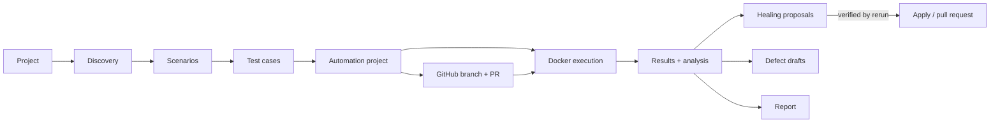

# AI Autonomous Testing Studio

A Streamlit application that takes a website URL and produces a reviewed, runnable, self-healing automated test suite:
website discovery, scenarios, test cases, automation code, GitHub commit/PR, containerised execution, failure analysis,
locator healing, defect drafts and reports. The language model is NVIDIA Nemotron
(`nvidia/nemotron-3.5-super-vl-120b-a12b`) through the OpenAI SDK.

The UI is Streamlit only. Nothing runs in the browser except Streamlit.

## Quick start

```powershell
py -m venv .venv ; .venv\Scripts\activate
pip install -r requirements.txt
python -m playwright install chromium
copy .env.example .env          # set NVIDIA_API_KEY (or MODEL_API_KEY)
streamlit run app.py
```

* Testing an app on `localhost` or an intranet host: set `ALLOW_PRIVATE_NETWORK=true`.
* No Docker on the machine: set `EXECUTION_MODE=local` (tests run as a separate OS process, without container isolation).
* Docker (recommended for execution): `docker compose up --build` (see "Docker").
* Keys can also live in `.streamlit/secrets.toml`; nothing is hard-coded.

## Workflow



Every AI output is a draft. Scenarios, test cases and the generated project each need a human approval, and AI changes
reset the approval of whatever they touch.

## Architecture

| Layer | Package | Responsibility |
| --- | --- | --- |
| UI | `app.py`, `ats/ui/` | Pages (Projects, Discovery, Scenarios, Test cases, Automation, GitHub, Execute, Results, Reports, Status and audit), sidebar tracker, live run view |
| Workflow | `ats/workflow.py` | Computes stage state from stored data (nothing is kept only in the session) |
| Model layer | `ats/ai/` | OpenAI-SDK client for Nemotron (streaming `reasoning_content`/`content`, thinking mode, retries, JSON repair, schema validation, call log) and the agents |
| Discovery | `ats/discovery/` | Isolated Playwright worker: crawl, DOM/accessibility extraction, screenshots, forms, auth |
| Locators | `ats/locators/` | Locator repository: ranked, deduplicated, uniqueness-checked selectors with alternatives |
| Generation | `ats/generation/` | Scenario and test-case services, framework adapters (Playwright Python/TypeScript/JavaScript, Selenium Python/Java), Excel exporters |
| Automation | `ats/automation/` | Script service, bundle store, validation against the locator repository, traceability |
| Execution | `ats/execution/` | Runner (Docker or local), JUnit and evidence parser, executor with cancel and live log |
| Analysis | `ats/analysis/` | Failure evidence, rule classifier, AI analysis, healing engine, defect builder |
| GitHub | `ats/github/` | REST client and service: branch, commit, pull request, import |
| Reporting | `ats/reporting/` | Report assembly and HTML / Excel / JSON / ZIP exporters |
| Storage | `ats/db.py`, `ats/repository.py` | SQLite behind a repository API (PostgreSQL-ready: all SQL lives in the repository) |
| Cross-cutting | `ats/config.py`, `ats/security.py`, `ats/logging_setup.py`, `ats/errors.py` | Settings, secret masking, URL safety, logging, user-facing errors |

## Agents

| Agent | Purpose |
| --- | --- |
| `WebDiscoveryAgent` | Understands the application from the crawled pages (purpose, user flows, risks) |
| `LocatorIntelligenceAgent` | Names elements by intent and ranks locator strategies |
| `ScenarioAgent` | Business scenarios by coverage level (BASIC to FULL, or custom categories) |
| `TestCaseAgent` | Detailed test cases with automation steps, one scenario at a time |
| `ScriptGenerationAgent` | Maps test-case steps to locator-repository elements (never invents selectors) |
| `FailureAnalysisAgent` | Classifies failures from error, DOM, screenshot and executed steps |
| `SelfHealingAgent` | Proposes replacement locators that must be present in the failing DOM |
| `ReportAgent` | Executive summary, risks and recommendations |
| `GitHubAgent` | Branch names, commit messages and PR text |

Agents never touch the filesystem, the database or the network directly; services do, and services validate every
agent output (schema, grounding in discovered elements, allowed actions).

## Nemotron layer

* Config: `MODEL_NAME`, `MODEL_BASE_URL`, `MODEL_API_KEY` / `NVIDIA_API_KEY`, `MODEL_TEMPERATURE`, `MODEL_TOP_P`,
  `MODEL_MAX_TOKENS`, `MODEL_SEED`, `MODEL_ENABLE_THINKING`.
* `enable_thinking` is sent as `extra_body={"chat_template_kwargs": {"enable_thinking": ...}}`.
* Streaming responses surface `reasoning_content` and `content` separately in the "AI model activity" panels.
* Replies are parsed as JSON, repaired when possible, validated with Pydantic, and re-requested with the validation
  error on failure. Only timings and token counts are logged (Status and audit page), never prompts or responses.
* Screenshots are sent to the vision-language model during discovery and failure analysis when `MODEL_USE_VISION=true`.

## Data model (SQLite)

`projects`, `discoveries`, `locators`, `scenarios`, `test_cases`, `bundles` (generated files live on disk), `github_links`,
`executions`, `results`, `healings`, `defects`, `audit_log`, `ai_calls`, `schema_version`. Rows are owner-scoped by a random
id kept in a browser cookie, so one browser never lists another browser's projects. This is separation, not authentication:
put the app behind your own login when exposing it to untrusted users.

## Execution

* Docker mode: Playwright projects run in the official Playwright images; Selenium projects in `ats-runner-selenium-python`
  / `ats-runner-selenium-java`, built on first use from `docker/runners/`. Resource limits come from `DOCKER_CPUS`,
  `DOCKER_MEMORY`, `DOCKER_SHM_SIZE`. Secrets are passed as environment variables inherited from the process, never on the
  command line.
* `localhost` base URLs are rewritten to `host.docker.internal` inside containers.
* Generated tests write evidence per test case (`steps.json`, `failure.json`, `dom.html`, `screenshot.png`) next to JUnit XML.
* Statuses: PASS, FAIL, HEALED (passed only after a verified locator fix), INCONCLUSIVE (flaky or unexplained), SKIPPED.

## Failure analysis and self-healing

1. Rule classifier and DOM check (is the locator still present? are alternatives matching?).
2. AI classification: LOCATOR DRIFT, TIMING, DATA, ENVIRONMENT, APPLICATION DEFECT, SCRIPT ERROR, and others.
3. Only fixable locator failures get proposals. A proposal must be grounded in the failing DOM and above a confidence threshold.
4. The affected tests are re-run with the patch. Only a passing rerun marks the fix `verified` and the test `HEALED`.
5. Policy `manual`: a person applies or rejects. Policy `auto_pr`: a pull request with the verified locator change is opened
   (never merged, never to the default branch). Behavior changes are reported as defect drafts, not healed.

## GitHub

The token is held in memory per project (never stored). Tests go to a new `ai-tests/...` branch; healed locators go to
`ai-heal/...`; both through pull requests. Committing to the default branch is refused.

## Docker

```powershell
copy .env.example .env
docker compose up --build
```

The studio container controls sibling runner containers through the Docker socket. Runner containers mount their workspace
from the host, so the data directory has the same path inside and outside the container (`ATS_DATA_DIR`, default
`/opt/ats-data`). Mounting the Docker socket gives the studio control over the host Docker daemon; run it only on trusted hosts.

## Security notes

* Secrets are masked in logs, reports, defects, audit entries and exports; generated code uses `{{env:NAME}}` placeholders resolved at run time.
* Target URLs are validated (scheme, private ranges unless `ALLOW_PRIVATE_NETWORK=true`). HTML reports are escaped, carry a CSP and embed no remote resources. Excel exports neutralise formula injection.
* File access in the bundle store rejects path traversal; secret files are excluded from ZIP and GitHub commits.

## Tests

```powershell
py -m pytest -q -p no:cacheprovider
```

Tests use a local fixture website, a fake model client and a fake GitHub API. Tests that need a browser are skipped when
Chromium is not installed.

## Known limitations

* Live NVIDIA calls, real GitHub, Docker execution and the TypeScript/JavaScript and Java projects were not exercised in
  automated tests here (they are covered by unit tests with fakes and by rendered-code checks only).
* The PostgreSQL backend is not implemented; the repository layer is the seam for it.
* Edge and WebKit availability depends on the runner image; Selenium images ship Chromium and Firefox only.
* Owner separation by cookie is not authentication.
